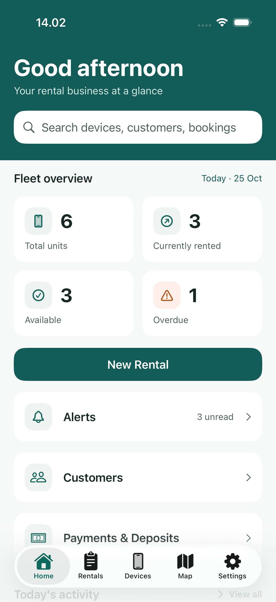
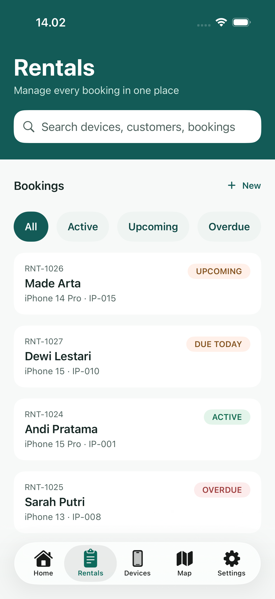
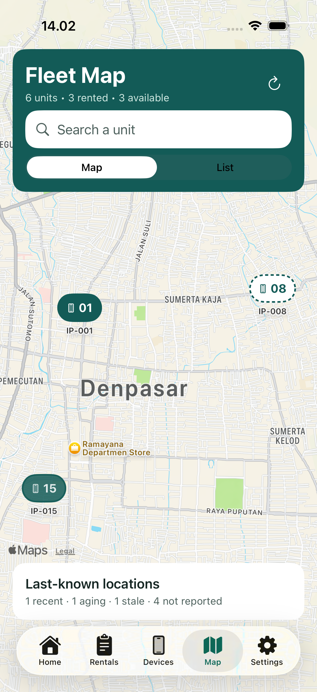
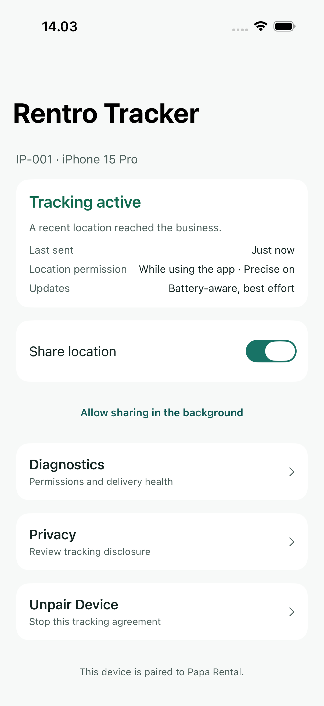

# Rentro

A native iOS app for running an iPhone rental business. Rentro covers the daily
work in one place: register devices, manage customers, book and complete
rentals, record pickups and returns, track payments and deposits, and see the
last reported location of each rented iPhone on a fleet map.

The project has two apps:

- **Rentro** (`RentroAdmin`): for the business owner and staff.
- **Rentro Tracker** (`RentroTracker`): installed on the rented iPhone. With the
  renter's consent it shares the phone's location with the business.

| Home | Rentals | Map | Tracker |
|---|---|---|---|
|  |  |  |  |

## Features

### Rentro (admin)

- **Sign in with Apple** only, with the session kept in the Keychain
- **Five tabs:** Home, Rentals, Devices, Map, Settings
- **Home:** what's due today, overdue rentals, income and alerts
- **New rental wizard** in four steps: customer → device → price → review
- **Booking conflict check**, so one device can never have two overlapping
  bookings
- **Rental detail** with pickup and return, late fees (per hour or per day) and
  a timeline of events
- **Payments and deposits** kept in separate ledgers. Amounts are stored as
  exact integers in Rupiah, never as floats
- **Devices:** inventory, status (enabled, maintenance, retired) and tracker
  pairing by QR code or manual code
- **Fleet map** of last known locations, always showing how old each one is
  (for example "Last reported 18 min ago")
- **Find My** shortcut that opens `icloud.com/find`. No private APIs and no
  scraping
- **Settings:** business profile, rental policies, notifications, appearance
  (System / Light / Dark), privacy, tracker sync
- Customers, history, alerts and a first-run brand intro that respects Reduce
  Motion

### Rentro Tracker

- Pairing with a one-minute code (QR scan or typed in)
- A consent screen before any location is shared
- Best-effort location in the background via Core Location
- Diagnostics screen and unpairing, which stops sharing right away

### Both apps

- Light and Dark mode with a teal/green accent
- English and Indonesian (`en`, `id`)
- Data sync between the two apps through CloudKit sharing

Out of scope on purpose: MDM, remote lock/wipe, and any promise of always-live
GPS.

## Tech stack

| | |
|---|---|
| Language | Swift 6 |
| UI | SwiftUI (native `TabView`, `NavigationStack`, MapKit) |
| Storage | SwiftData (local-first) with a versioned schema and migration plan |
| Sync | CloudKit, container `iCloud.com.rentro.shared` |
| Auth | Sign in with Apple, Keychain |
| Location | Core Location (tracker app) |
| Localization | String Catalogs (`.xcstrings`) |
| Project | XcodeGen (`project.yml`) |
| Target | iOS 26.0+, iPhone, portrait |

No third-party dependencies.

## Getting started

Requirements: Xcode 26+, [XcodeGen](https://github.com/yonaskolb/XcodeGen).

```bash
brew install xcodegen
```

```bash
xcodegen generate
```

```bash
open Rentro.xcodeproj
```

Then pick the **RentroAdmin** or **RentroTracker** scheme and run it.

Run `xcodegen generate` again after every pull. If you skip it, the installed
app can miss its iCloud entitlement and crash at launch.

To run on a real device, change `DEVELOPMENT_TEAM` in `project.yml` to your own
team. If the bundle IDs `com.rentro.admin` / `com.rentro.tracker` are taken,
change them in `project.yml`, and change the container ID in both
`.entitlements` files and in `CloudKitConfig`.

## Tests

| Scheme | Targets |
|---|---|
| `RentroAdmin` | `RentroTests` (unit), `RentroUITests` (UI, accessibility audit, screenshot tour) |
| `RentroTracker` | `RentroTrackerTests` (unit), `RentroTrackerUITests` (UI) |

```bash
xcodebuild -project Rentro.xcodeproj -scheme RentroAdmin -destination 'platform=iOS Simulator,name=iPhone 17' -derivedDataPath build test
```

The unit tests cover booking, pricing and policies, alerts, location freshness
and the tracker core.

## Project structure

```
Apps/
  RentroAdmin/
    App/              app entry point
    Domain/           models, booking, alerts, locations, auth, store, fixtures
    Features/         screens: Home, Rentals, Devices, Map, Settings, auth, forms
    DesignSystem/     shared components and the brand intro
    Resources/        Localizable.xcstrings, entitlements
  RentroTracker/
    App/              app entry, TrackerModel, LocationProvider, FleetLink
    Features/         pairing, consent, home, diagnostics, unpair
    Resources/        Info.plist, string catalogs, entitlements, assets
Shared/               code used by both apps
  DesignSystem/       color/spacing tokens and core components
  CloudKit*.swift     schema, gateways, self-test
  Pairing, Freshness, Money, TrackerDomain, TrackerTransport, KeychainSlot, ...
Tests/
  Unit/  UITests/  TrackerUnit/  TrackerUITests/
scripts/              localization and screenshot helpers
Docs/                 device testing, localization, phase C notes, screenshots
project.yml           XcodeGen project definition
```

## Localization

English is the source language. The Indonesian strings live in
`scripts/id_strings.py`. After you change UI text:

1. Build both apps with `-derivedDataPath build`
2. `scripts/sync_strings.sh` to pull new keys into the catalogs
3. Add the Indonesian text to `scripts/id_strings.py`
4. `python3 scripts/apply_id.py` (fails if a key is missing or a format
   specifier doesn't match)

See [Docs/LOCALIZATION.md](Docs/LOCALIZATION.md).

## Screenshots

`scripts/screenshots.sh [simulator-udid]` runs the screenshot tour and saves every
screen in Light and Dark to `Docs/screenshots/{light,dark}`.

## Documentation

| File | Contents |
|---|---|
| [RENTRO_PRD_v2.0.md](RENTRO_PRD_v2.0.md) | product requirements and acceptance tests |
| [V1_TO_V2_CHANGELOG.md](V1_TO_V2_CHANGELOG.md) | what changed from PRD v1.0 |
| [FIGMA_SCREEN_MANIFEST_v2.0.json](FIGMA_SCREEN_MANIFEST_v2.0.json) / [FIGMA_SCREEN_MATRIX_v2.0.csv](FIGMA_SCREEN_MATRIX_v2.0.csv) | screen-to-Figma mapping |
| [Docs/DEVICE_TEST.md](Docs/DEVICE_TEST.md) | testing on two real iPhones with iCloud |
| [Docs/PHASE_C_REQUIREMENTS.md](Docs/PHASE_C_REQUIREMENTS.md) | what still needs a developer team or real devices |

## Status

The admin app and the tracker run in the simulator with an in-process backend.
CloudKit sharing between two real iPhones has not been tested yet. See
[Docs/DEVICE_TEST.md](Docs/DEVICE_TEST.md) for the steps.

## Author

Rizky Insania Ramadhani ([@kykyramadhani](https://github.com/kykyramadhani))
